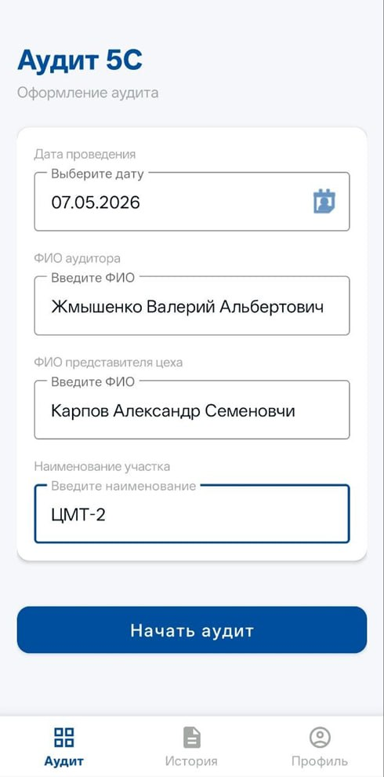
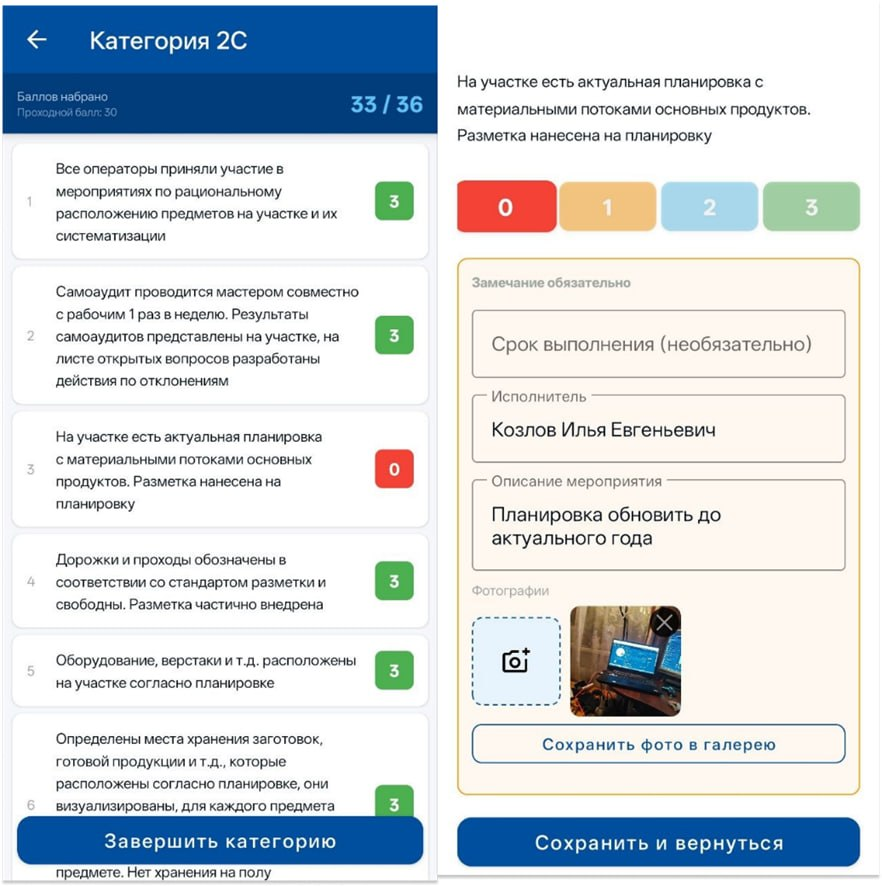

# 📋 Audit5S — мобильное приложение для аудита 5С

Android-приложение для проведения аудитов по системе **5С** (система организации рабочего места из бережливого производства) прямо на производственном участке. Аудитор отвечает на вопросы чек-листа, ставит баллы, фиксирует замечания с фотографиями и сразу получает итоговый результат с возможностью экспорта отчёта.

Разработчик в приложении: **АО УК «БМЗ»**.

<p align="center">
  
  
</p>

## 💡 Зачем это нужно

Бумажные чек-листы 5С неудобны: баллы приходится считать вручную, фотографии нарушений хранятся отдельно от отчёта, а замечания легко потерять. Audit5S собирает всё в одном месте: оценки, замечания, исполнителей, сроки и фото, а отчёт формируется в один тап.

## ✨ Возможности

- **Оформление аудита**: дата проведения, ФИО аудитора, ФИО представителя цеха, наименование участка.
- **Чек-лист по категориям** (1С, 2С, 3С, 4С, 5С): по каждому вопросу оценка от **0 до 3**, по категории автоматически считается набранный балл и показывается проходной (например, `33 / 36`, проходной балл 30).
- **Замечания** к вопросам: описание мероприятия, исполнитель, срок выполнения (необязательно), обязательный комментарий при низкой оценке.
- **Фотофиксация**: снимок камерой или выбор из галереи, несколько фото к замечанию, сохранение фото в галерею.
- **Отметка о выполнении**: выбор даты фактического выполнения замечания, возможность снять отметку.
- **Итоговый результат** аудита (общий балл и присвоенная категория) и список всех замечаний.
- **Экспорт отчёта** с фотографиями в **PDF**, **Excel** и **Word**.
- **Редактирование** данных аудита и оценок уже после завершения.
- **История аудитов** со списком проведённых проверок.
- **Профиль аудитора**: имя, статистика (количество аудитов, замечаний), светлая и тёмная тема.
- Заготовка под **интеграцию с 1С** (в текущей версии не настроена).

## 🔄 Как проходит аудит

1. На вкладке **«Аудит»** заполнить данные: дата, аудитор, представитель цеха, участок → **«Начать аудит»**.
2. Пройти категории 1С–5С: выставить оценки 0–3 по каждому пункту.
3. Для пунктов с замечаниями указать исполнителя, срок и описание, при необходимости добавить фото.
4. Нажать **«Завершить категорию»**, затем завершить аудит и посмотреть итоговый результат.
5. Экспортировать отчёт (PDF / Excel / Word) или вернуться к нему позже в **«Истории»**.
6. По мере устранения замечаний отмечать их выполненными с датой.

## 🧱 Технологии

- **Android**, язык **Kotlin**
- Сборка: **Gradle (Kotlin DSL)**
- Внедрение зависимостей: **Hilt**
- Кодогенерация: **KSP**
- Навигация по трём разделам: **Аудит / История / Профиль**

## 🗂️ Структура репозитория

```
Audit5S/
├── app/                  # исходный код приложения
├── gradle/               # версии зависимостей (libs.versions.toml) и wrapper
├── build.gradle.kts      # корневой файл сборки
├── settings.gradle.kts
├── gradle.properties
├── gradlew / gradlew.bat
└── README.md
```

## 🚀 Запуск

1. Установите [Android Studio](https://developer.android.com/studio) и JDK, который рекомендует ваша версия студии.
2. Склонируйте репозиторий:
   ```bash
   git clone https://github.com/Chaykaman/Audit5S.git
   ```
3. Откройте папку проекта в Android Studio и дождитесь синхронизации Gradle.
4. Подключите устройство или запустите эмулятор и нажмите **Run ▶**.

Либо соберите из командной строки:

```bash
./gradlew assembleDebug
```

APK появится в `app/build/outputs/apk/debug/`.

> Для работы с фото приложению нужны разрешения на камеру и доступ к галерее.

## 🗺️ Планы развития

- [ ] Интеграция с 1С
- [ ] Уведомления о сроках выполнения замечаний
- [ ] Статистика по участкам и динамика результатов
